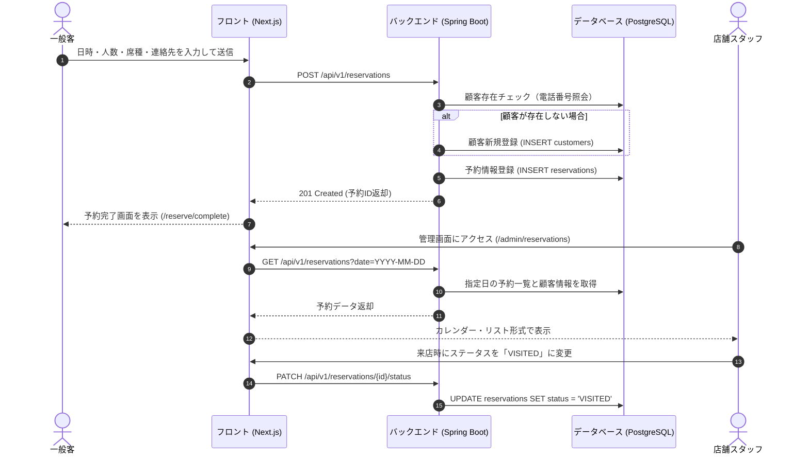
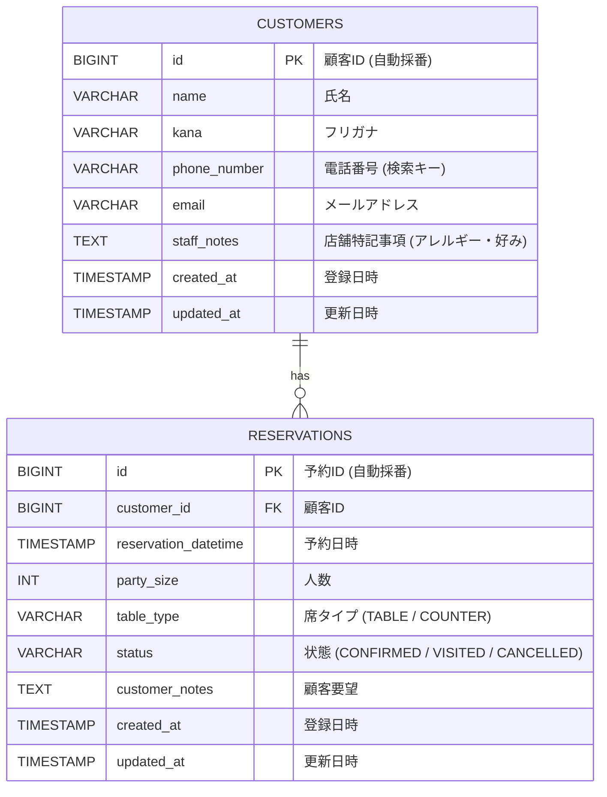

# TableReserve (飲食店向け 予約＆顧客管理システム) 総合仕様書

本ドキュメントは、システム開発・AI実装指示、およびクライアント提示用の設計資料として、要件定義からインフラ構成・DB設計・API仕様までを一括統合したマスター仕様書です。

---

## 1. プロダクト概要 & 開発スコープ

### 1.1 背景と目的
* **ターゲット:** 個人経営・小規模飲食店の現場スタッフ、および来店予約を行う一般客
* **解決する課題:**
  * 電話や紙の予約台帳による転記ミス、ダブルブッキングの防止
  * 来店履歴やアレルギー、顧客の好みが接客現場で共有できていない課題の解決
* **コアバリュー:**
  * 顧客はスマートフォンから数タップで即時予約が完了
  * 店舗スタッフは日別・週別の予約一覧からステータス管理および顧客カルテを1画面で把握可能

### 1.2 機能スコープ (MVP)
| 区分 | 対象機能 | 概要 |
|---|---|---|
| **一般顧客向け** | 予約フォーム (`/reserve`) | カレンダーから日付・時間・人数・席タイプを選択し、氏名・連絡先・要望を入力 |
| | 予約完了画面 (`/reserve/complete`) | 予約確定通知および予約番号・内容サマリーの表示 |
| **店舗スタッフ向け** | 予約ダッシュボード (`/admin/reservations`) | 日別予約一覧表示、ワンクリックでのステータス更新 (`CONFIRMED` / `VISITED` / `CANCELLED`) |
| | 顧客台帳画面 (`/admin/customers`) | 顧客一覧、累計来店回数、最終来店日、アレルギー・特記事項メモの閲覧・更新 |
| **スコープ外 (次期)** | 決済 / 通知 / 複雑な権限 | 事前決済（Stripe）、SMS/LINE自動リマインド、スタッフ個別ロール制御、フロア配席シミュレーション |

---

## 2. 全体アーキテクチャ & 技術スタック（全12レイヤー）

### 2.1 システム構成図 (Mermaid)
```mermaid
flowchart TD
    subgraph Client [クライアント環境]
        UserBrowser[一般顧客: スマホ/PC]
        AdminBrowser[店舗スタッフ: タブレット/PC]
    end

    subgraph Frontend [フロントエンド / Vercel]
        NextApp[Next.js 14 App Router]
    end

    subgraph Backend [バックエンド / Render]
        SpringApp[Spring Boot 3 REST API]
    end

    subgraph Database [データベース / Neon]
        Postgres[(PostgreSQL 16)]
    end

    UserBrowser -->|HTTPS| NextApp
    AdminBrowser -->|HTTPS| NextApp
    NextApp -->|REST API (JSON)| SpringApp
    SpringApp -->|Spring Data JPA| Postgres
```

### 2.2 全12レイヤー技術選定一覧
| # | レイヤー | 採用技術・サービス | 運用ルール・設定方針 |
|---|---|---|---|
| **1** | **ソース管理 (VCS)** | GitHub (ポリレポ) | `tablereserve-web` と `tablereserve-api` に分離。`main` ブランチ直Pushでスピード優先。 |
| **2** | **パッケージ & ビルド** | npm / Gradle | フロント: `Node.js 20+`, `npm`<br>バック: `Java 21`, `Gradle Wrapper` |
| **3** | **CI / CD** | Git Push連動 自動ビルド | VercelおよびRenderのリポジトリ監視機能を利用（CIスクリプト手動作成は不要）。 |
| **4** | **ホスティング (インフラ)** | Vercel + Render | フロント: Vercel Hobby (無料 / 自動SSL)<br>バック: Render Web Service (Free/Starter) |
| **5** | **データベース** | PostgreSQL 16 (Neon / Supabase) | フルマネージドクラウドDB。ローカルDB構築不要、URI接続。スキーマはDDL適用。 |
| **6** | **環境変数 & シークレット** | `.env.local` / `application.yml` | ローカルはファイル管理（Git除外必須）。本番は各ホスティングのダッシュボードで設定。 |
| **7** | **API仕様 & データ連携** | REST API (JSON) + OpenAPI | Springdoc OpenAPI (Swagger UI) を導入。`/swagger-ui.html` で動作確認。 |
| **8** | **認証 & 認可** | MVP固定モック運用 | 管理画面は固定管理者として即利用可能（認証実装工数を削減、次期でSupabase Auth導入）。 |
| **9** | **UI / スタイル基盤** | Tailwind CSS + shadcn/ui | Radix UIベース。Lucide Reactアイコン、date-fnsによる日付操作。 |
| **10** | **コード品質 & 整形** | Prettier / ESLint / IDE標準 | エディタ保存時の自動整形のみ（厳格なCIブロックは回避）。 |
| **11** | **ログ & 可観測性** | 標準出力 + `/actuator/health` | Spring Boot Actuator導入。Render/Vercelの標準ログコンソールで監視。 |
| **12** | **ドキュメント** | 本仕様書 (`SPEC.md`) ＋ README | GitHubトップに構成図、画面プレビュー、API概要を掲載。 |

---

## 3. 画面一覧 & ユーザーフロー

### 3.1 画面構成
```text
/reserve                    - 一般客: 日時・人数選択および顧客情報入力
/reserve/complete           - 一般客: 予約完了通知・予約番号表示
/admin/reservations         - 店舗: 日別予約一覧、ステータス変更、新規電話予約手動登録
/admin/customers            - 店舗: 顧客一覧（来店数・最終日）、スタッフメモ更新
```

### 3.2 ユーザーフロー


---

## 4. データベース設計（ER図 & DDL）

### 4.1 ER図 (Mermaid)


### 4.2 DDL (PostgreSQL)
```sql
-- 顧客テーブル
CREATE TABLE customers (
    id BIGSERIAL PRIMARY KEY,
    name VARCHAR(100) NOT NULL,
    kana VARCHAR(100),
    phone_number VARCHAR(20) NOT NULL,
    email VARCHAR(255),
    staff_notes TEXT,
    created_at TIMESTAMP WITH TIME ZONE DEFAULT CURRENT_TIMESTAMP,
    updated_at TIMESTAMP WITH TIME ZONE DEFAULT CURRENT_TIMESTAMP
);

CREATE INDEX idx_customers_phone ON customers(phone_number);

-- 予約テーブル
CREATE TABLE reservations (
    id BIGSERIAL PRIMARY KEY,
    customer_id BIGINT NOT NULL REFERENCES customers(id) ON DELETE RESTRICT,
    reservation_datetime TIMESTAMP WITH TIME ZONE NOT NULL,
    party_size INT NOT NULL CHECK (party_size > 0),
    table_type VARCHAR(20) DEFAULT 'TABLE',
    status VARCHAR(20) NOT NULL DEFAULT 'CONFIRMED',
    customer_notes TEXT,
    created_at TIMESTAMP WITH TIME ZONE DEFAULT CURRENT_TIMESTAMP,
    updated_at TIMESTAMP WITH TIME ZONE DEFAULT CURRENT_TIMESTAMP
);

CREATE INDEX idx_reservations_datetime ON reservations(reservation_datetime);
CREATE INDEX idx_reservations_status ON reservations(status);
```

---

## 5. REST API エンドポイント定義

通信方式: HTTPS / JSONフォーマット (UTF-8)

| # | Method | Path | Summary | Request Body / Query Params | Response Example (Status) |
|---|---|---|---|---|---|
| 1 | `POST` | `/api/v1/reservations` | 新規予約作成 | `{ "name": "山田 太郎", "kana": "ヤマダ タロウ", "phoneNumber": "09012345678", "email": "yamada@example.com", "reservationDatetime": "2026-10-20T19:00:00Z", "partySize": 4, "tableType": "TABLE", "customerNotes": "窓際希望" }` | `201 Created`<br>`{ "reservationId": 101, "status": "CONFIRMED" }` |
| 2 | `GET` | `/api/v1/reservations` | 予約一覧取得 | `?date=2026-10-20&status=CONFIRMED` | `200 OK`<br>`[ { "id": 101, "customerName": "山田 太郎", "phoneNumber": "09012345678", "reservationDatetime": "2026-10-20T19:00:00Z", "partySize": 4, "tableType": "TABLE", "status": "CONFIRMED", "customerNotes": "窓際希望" } ]` |
| 3 | `PATCH` | `/api/v1/reservations/{id}/status` | 予約ステータス更新 | `{ "status": "VISITED" }` | `200 OK`<br>`{ "id": 101, "status": "VISITED" }` |
| 4 | `GET` | `/api/v1/customers` | 顧客一覧・集計取得 | `?keyword=山田` | `200 OK`<br>`[ { "id": 1, "name": "山田 太郎", "phoneNumber": "09012345678", "visitCount": 3, "lastVisitedAt": "2026-09-15T18:30:00Z", "staffNotes": "窓際希望、甲殻類アレルギー" } ]` |
| 5 | `PATCH` | `/api/v1/customers/{id}` | 顧客メモ更新 | `{ "staffNotes": "窓際希望、甲殻類アレルギー、白ワイン好む" }` | `200 OK`<br>`{ "id": 1, "staffNotes": "..." }` |
| 6 | `GET` | `/actuator/health` | 死活監視用エンドポイント | なし | `200 OK`<br>`{ "status": "UP" }` |

---

## 6. プロジェクト構成 & デプロイ設定

### 6.1 リポジトリ・ディレクトリ構造
```text
予約&顧客管理システム/
├── SPEC.md                      # 本仕様書（マスターファイル）
├── tablereserve-web/            # フロントエンド (Next.js 14)
│   ├── app/
│   │   ├── reserve/             # 予約入力画面
│   │   ├── reserve/complete/    # 予約完了画面
│   │   ├── admin/reservations/  # 店舗予約一覧・更新ダッシュボード
│   │   └── admin/customers/     # 顧客台帳管理
│   ├── components/ui/           # shadcn/ui コンポーネント群
│   ├── lib/api.ts               # バックエンドAPI接続用クライアント
│   └── .env.local               # NEXT_PUBLIC_API_BASE_URL=http://localhost:8080
│
└── tablereserve-api/            # バックエンド (Spring Boot 3)
    ├── src/main/java/com/example/tablereserve/
    │   ├── controller/          # ReservationController, CustomerController
    │   ├── service/             # ReservationService, CustomerService
    │   ├── repository/          # ReservationRepository, CustomerRepository
    │   ├── entity/              # Reservation, Customer
    │   └── dto/                 # Request/Response DTO
    └── src/main/resources/
        └── application.yml      # DB接続URI, CORS許可ドメイン設定
```

### 6.2 バックエンド初期設定例 (`application.yml`)
```yaml
spring:
  application:
    name: tablereserve-api
  datasource:
    url: ${DATABASE_URL}
    driver-class-name: org.postgresql.Driver
  jpa:
    hibernate:
      ddl-auto: validate
    properties:
      hibernate:
        format_sql: true
    show-sql: true

# CORS設定（Next.jsからの通信を許可）
cors:
  allowed-origins:
    - "http://localhost:3000"
    - "https://*.vercel.app"

# Swagger UI & Actuator
springdoc:
  swagger-ui:
    path: /swagger-ui.html
management:
  endpoints:
    web:
      exposure:
        include: health, info
```